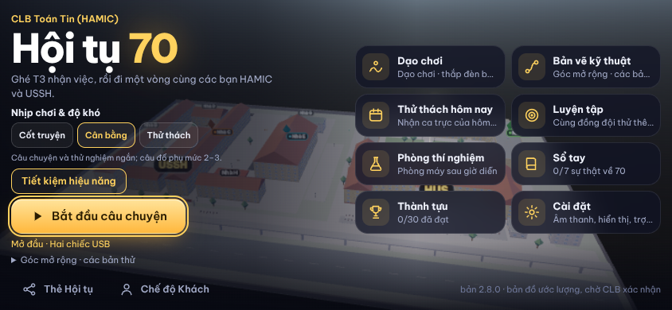

# Hội tụ 70

Game kể chuyện và giải đố trên web của CLB Toán Tin (HAMIC), bản 2.8.0. Người chơi là thành viên mới đi một vòng sa bàn 3D khuôn viên USSH × HUS để trả lời câu hỏi "Vì sao đèn lệch?": gặp 12 nhân vật, giải 13 câu đố và minigame Toán – Tin, đưa ra 8 quyết định và đến một trong 6 kết cục của Đêm Hội tụ. Kết cục do lựa chọn quyết định; khoảng 70% tổ hợp lựa chọn dẫn tới kết cục hài "sa bàn nổ tung" (hoạt hình, có chú thích mô phỏng).



## Chạy

```bash
cd web
npm install
npm run dev          # http://localhost:5173
npm run check        # kiểm đáp án, luật truyện, tỉ lệ kết cục + kiểm chuỗi giao diện
npm run build        # tsc + vite → web/dist (tĩnh, chạy offline sau lần mở đầu)
npm run preview      # phục vụ web/dist tại http://127.0.0.1:4173
npm run test:story   # (cần preview đang chạy) đi hết truyện bằng trình duyệt: bond, độ khó, kết cục, bản lưu cũ
npm run capture      # (cần preview đang chạy) chụp ảnh màn hình vào docs/screenshots
```

`test:story` và `capture` dùng Playwright. Nếu máy đã có Playwright kèm trình duyệt ở chỗ khác, đặt `PLAYWRIGHT_MODULE=/đường/dẫn/playwright`; nếu không, chạy `npx playwright install chromium` rồi đặt `CAPTURE_CHANNEL=chromium`.

Sinh lại dữ liệu màn chơi tự động (Python 3, không cần thư viện ngoài):

```bash
python3 content/gen_levels.py --out web/public/data   # 266 màn, 445 phép kiểm, lint chuỗi, sha256 cố định
```

## Cách chơi

- Điện thoại: chỉ chơi ngang. Kéo joystick ở góc trái để đi, bấm nút lớn ở góc phải để nói chuyện hoặc thắp đèn. Bản đồ nhỏ ở góc phải trên; bấm vào một điểm để được dẫn đường.
- Máy tính: WASD hoặc mũi tên để đi, E nói chuyện, L thắp đèn, J mở Sổ, M bật/tắt bản đồ, Esc đóng hộp thoại.
- Màn tiêu đề có ba nhịp chơi: Cốt truyện (dễ, lời dẫn đơn giản), Cân bằng, Thử thách (câu đố khó hơn).
- Hack mode (Ctrl+Shift+H hoặc `?hack=70`): xem thẳng sáu kết cục và các biến thể E2, nhảy tới điểm dừng bất kỳ. Chạy trên bản sao trong bộ nhớ, bản lưu thật không đổi.

## Kết cục

| Mã | Kết cục | Cách đạt (tóm tắt) |
|---|---|---|
| E1 | Đêm Hội tụ | Chọn an toàn cả tám lần |
| E2 | Sự cố sa bàn: nổ tung | Tổng rủi ro các lựa chọn ≥ ngưỡng; nguyên nhân hiển thị là sai sót gốc nặng nhất |
| E3 | Cầu ánh sáng Tự nhiên – Nhân văn | Giữ nguyên lời ghi, còn sai sót nhỏ |
| E4 | Drone xếp thành 07 | Bản vẽ drone nhìn từ phía sân khấu |
| E5 | Pháo hoa bay mãi | Cho pháo vút lên không dừng |
| E6 | Số kỳ lạ | Đủ 7 sự thật về 70, xếp pháo theo các ước của 70 |

Chi tiết, bảng trọng số và tỉ lệ: [docs/STORY_BIBLE.md](docs/STORY_BIBLE.md) mục 6, [docs/ENDINGS.md](docs/ENDINGS.md).

## Cấu trúc

| Thư mục / tệp | Nội dung |
|---|---|
| `web/public/data/story.json` | Cốt truyện 2.8: chương, điểm dừng, quyết định, NPC, nhánh bond, tin nhắn, đèn, kết cục. Văn bản là khóa `story.*` trong `i18n/vi.json`. |
| `web/public/data/config.json` | Cấu hình, gồm `endings` (trọng số rủi ro, ngưỡng, tỉ lệ mục tiêu, công tắc cảnh nổ). |
| `web/public/data/map.json` | Bản đồ khuôn viên (ước lượng), điểm dừng và tên ngắn dùng trong lời thoại (`{place:id}`). |
| `web/public/data/` (còn lại) | Màn chơi, thành tựu, sự thật về 70, chuỗi giao diện, dữ liệu sinh tự động. |
| `web/src/puzzles/logic/` | Luật chấm thuần: câu đố (`analysis`, `linear`, `blocks`, `discrete`), minigame truyện (`activities.ts`), cốt truyện và kết cục (`story.ts`). |
| `web/src/ui/screens/walk.ts`, `web/src/ui/story/` | Màn đi bộ, minigame, Sổ, tin nhắn, bản đồ nhỏ, bảng kết cục. |
| `web/src/scene/` | Sa bàn 3D (Three.js), nhân vật, cảnh kết cục. |
| `web/src/ui/rich.ts` | Hiển thị công thức (KaTeX, tải khi cần) và giả mã thuật toán. |
| `web/scripts/` | `check-answers.ts`, `check-strings.mjs`, `story-e2e.mjs`, `story-driver.mjs`, `capture.mjs`, `build-map.mjs`. |
| `content/` | `gen_levels.py` và dữ liệu gốc v2.2 để đối chiếu. |
| `docs/` | GDD, STORY_BIBLE, ENDINGS, WALKTHROUGH, STORY_PLAN, ảnh chụp, `archive/` (tài liệu 2.7.0). |
| `legacy/campus/` | Dữ liệu gốc của bản đồ; mô hình trong game sinh bằng `web/scripts/build-map.mjs`. |

## Thêm nội dung

- Lời thoại, tên, đề minigame: sửa giá trị trong `web/public/data/i18n/vi.json` (khóa `story.*`). Tên địa điểm viết bằng `{place:id}` (viết hoa chữ đầu: `{Place:id}`).
- Điểm dừng mới: thêm vào `story.json → stops` (chương, NPC, `activity` có `type`, `decision`, bằng chứng, vật phẩm, sự thật). Minigame mới cần hàm chấm thuần trong `puzzles/logic/activities.ts` và ca kiểm trong `scripts/check-answers.ts`.
- Đổi tỉ lệ kết cục: sửa `config.json → endings.risk` hoặc `threshold`, chạy `npm run check:answers` để xem tỉ lệ mới; kiểm thử báo lỗi nếu lệch `target` quá `tolerance`.
- Công thức: viết `$...$` hoặc `$$...$$` trong chuỗi; giả mã thuật toán đặt trong `[[algo]] ... [[/algo]]`.
- `npm run check:strings` báo khóa thiếu, khóa `story.*` mồ côi và lỗi lint lời dẫn mức dễ (≤ 20 từ, ≤ 3 số mỗi câu, không thuật ngữ).

## Ràng buộc nội dung

- Lõi là Toán – Tin đã kiểm; cốt truyện, NPC hư cấu và chi tiết lịch sử nền theo GDD mục 2.1 (đã nới lỏng). Không người thật, logo hay ảnh thật.
- Không đồng hồ đếm ngược, không nhấp nháy quá 3 lần/giây, không phạt, không thành tựu tiêu cực. Cảnh E2 theo GDD mục 5.4: khối rơi chậm, hoa giấy, không người, không chớp sáng, có nút Bỏ qua và chế độ mờ dần.
- Bản đồ là ước lượng (`mapVerified: false`). Việc cần CLB xác nhận: GDD Phụ lục.
